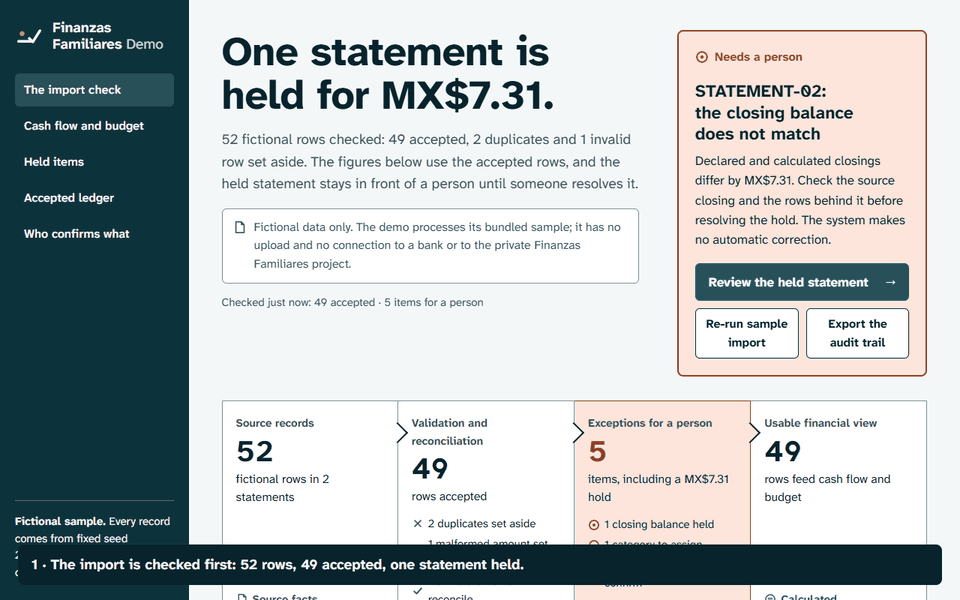
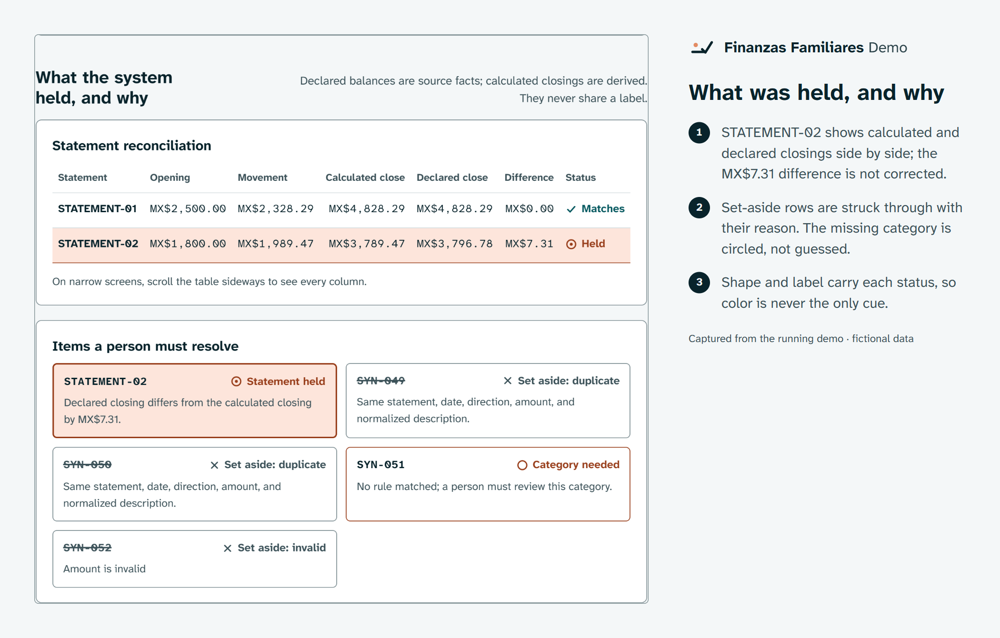
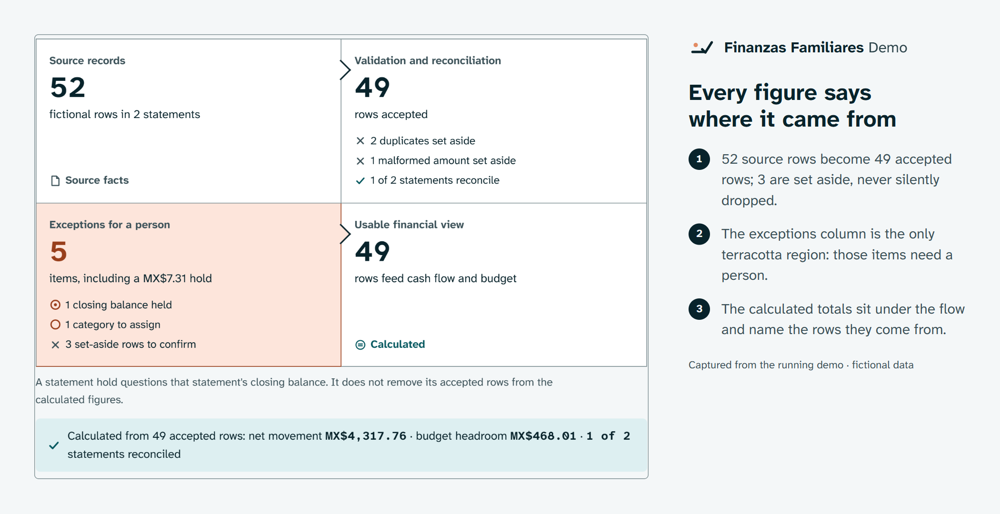
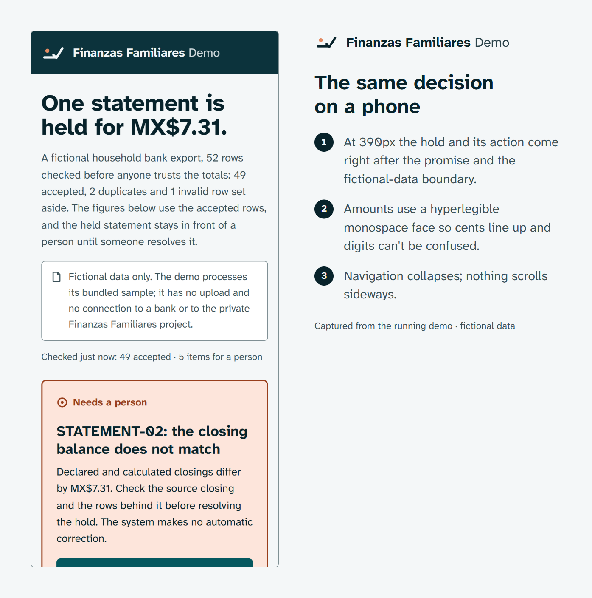

<picture>
  <source media="(prefers-color-scheme: dark)" srcset="docs/brand/hero-dark.png">
  
</picture>

**[Open the live demo](https://leonelivancortesrodriguez.github.io/finanzas-familiares-demo/)** · [Run it locally](#run-and-verify) · [Leonel's role](#leonels-role-and-decisions)

A fictional household bank export, checked line by line: the demo shows which figures can be relied on and keeps every duplicate, bad row, and unbalanced statement in front of a person until it is resolved. It processes only its bundled sample. There is no upload and no connection to a bank.

## The problem

A finance dashboard looks settled even when the import underneath it contains repeated rows, a malformed amount, or a statement whose closing balance doesn't match. Many tools hide those problems or quietly "fix" them, and the person reading the totals can't tell what is safe to use.

## See one review, start to finish

<picture>
  <source media="(prefers-reduced-motion: reduce)" srcset="docs/brand/demo-poster.png">
  
</picture>

The held statement leads, its two closings sit side by side, every set-aside row keeps its reason, and the open item traces back to its source row. [MP4 version](docs/brand/demo.mp4).

## How the workflow runs

`source records → validation and reconciliation → exceptions → usable financial view`

1. **Source records.** 52 fictional rows in two statements, generated from seed `20261026`, plus declared opening and closing balances and budget limits. These are *source facts*.
2. **Validation and reconciliation.** [`src/engine.mjs`](src/engine.mjs) validates dates and integer cents, normalizes labels, holds exact duplicate fingerprints, applies named category rules, and calculates each statement's closing from its accepted rows.
3. **Exceptions.** Two duplicates and one malformed amount are set aside with their reasons. One accepted row has no matching category rule. One statement's declared closing differs from the calculated closing by MX$7.31. That makes five items for a person.
4. **Usable view.** Cash flow and budget variance are calculated from the 49 accepted rows. A statement hold questions that statement's closing balance; it does not remove the statement's accepted rows from the figures.

The system never invents a correction.

| The system calculates | A person confirms |
| --- | --- |
| Date and integer-cent validation | Whether an excluded row was really invalid |
| Duplicate fingerprints | Whether a held duplicate is a true repeat |
| Category from named keyword rules | Any category the rules could not assign |
| Calculated statement closing | Why a declared closing doesn't match, and what to do about it |
| Cash flow and budget variance from accepted rows | Whether the figures are fit for a decision |

## Result and evidence

| Status | What it covers | Where to check |
| --- | --- | --- |
| Implemented and tested | Validation, duplicate holding, category rules, reconciliation, review queue, audit-trail export | `npm test` (Node test runner with planted defects), [`tests/engine.test.mjs`](tests/engine.test.mjs) |
| Tested by mutation | Balance, duplicate, and amount defects are each caught | `npm run test:mutation` |
| Checked for drift | The committed sample matches the fixed-seed generator; the totals are 52, 49, 5, and 1 of 2 | `node scripts/verify.mjs` |
| Not claimed | Use on real household data, financial advice, a trained categorizer, production readiness | No evidence in this repository |

The **Export the audit trail** button downloads `sourceFacts`, `derived`, `manualReview`, and `auditTrail` as separate JSON fields. It records decisions and reasons, not every original rejected source row.

## Product views







## Leonel's role and decisions

**Problem chosen.** Show that a household finance view can say which figures it calculated and which ones a person still has to confirm.

**Role.** Leonel set the product goal and the control requirements: source-to-output traceability, explicit review states, and a control view an operations leader can read quickly. Coding agents helped implement this public demonstration. Its logic and fixtures were written for this repository; the private Finanzas Familiares application and its records were not copied.

**Decisions that shape it**

- *The exception leads.* A held statement outranks every routine total on the first screen.
- *Set aside, never delete.* Excluded rows stay visible with their reason, because a person confirms exclusions too.
- *Accepted and categorized are separate.* A row without a category rule still counts in the figures; its category waits for review.
- *A hold questions a balance, not the rows.* Held statements keep their accepted rows in the totals.
- *No automatic correction.* The MX$7.31 difference stays open until someone checks the source.

**Constraints.** Fictional data only; no paid API, database, login, or package install to run it; the server binds to `127.0.0.1`; integer cents throughout.

**Observed results.** Verify, tests, mutation, contrast, and privacy checks pass, and the build packages a deterministic release.

**Technologies.** Browser JavaScript modules, HTML, CSS, the Node.js test runner, and Python for ZIP packaging. Playwright Core and FFmpeg render the README images only.

## Broader project and public boundary

This is a separate public illustration of selected control ideas from Leonel's private Finanzas Familiares project. The private work includes multi-bank intake, household-scoped import history and reversal, and source-based verification; its systems and records are not included here. Historical statement gold intake and categorization remain subject to review and acceptance gates, and this demo makes no completion claim for any private-project stage.

## Limitations

The fixed-seed sample and keyword rules demonstrate control flow, not financial advice, a trained categorizer, or production readiness. Reconciliation differences and category review need a person. The interface processes only its bundled sample and has no import surface for other files.

## Run and verify

Requires Node.js 20+, and Python 3.10+ for ZIP packaging.

```powershell
npm run start      # http://127.0.0.1:4174
npm run verify     # fixture drift, tests, mutation, contrast, privacy
npm run build      # release/finanzas-familiares-demo.zip and CONTENT_INVENTORY.sha256
```

The sample is committed so the app works immediately. `npm run generate` recreates its CSV and controls from seed `20261026`. To regenerate the README images, install the development dependency (`npm install`), keep `npm run start` running, and run `npm run render`; it needs Chrome or Edge and FFmpeg.

## Privacy, assets, and license

Every record, date, label, and amount is fictional. There is no connection to a bank, household account, employer, private workbook, production database, or the private application. See [SECURITY.md](SECURITY.md).

Leonel licenses this demonstration under the [MIT License](LICENSE). Atkinson Hyperlegible Next and Mono are bundled under the SIL Open Font License; see [third-party notices](THIRD_PARTY_NOTICES.md). Publication of future changes and any LinkedIn use require a separate owner decision.
