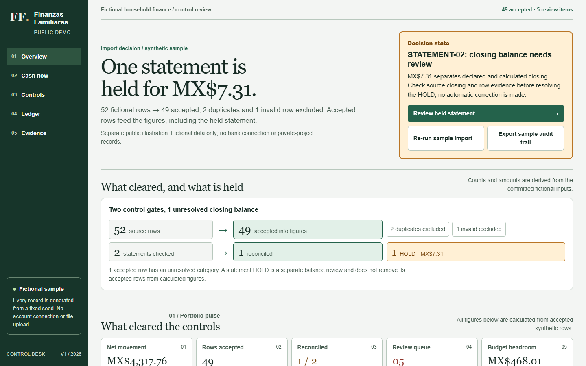

# Finanzas Familiares Demo

**[View the live fictional control desk](https://leonelivancortesrodriguez.github.io/finanzas-familiares-demo/)**

This public demo illustrates selected control ideas from the broader private Finanzas Familiares project: visible import decisions, reconciliation, review queues, and traceable calculations. It is a separate implementation using entirely fictional data. The private project also includes multi-bank intake, household-scoped import history and reversal, and source-based verification; its systems and records are not included here. Features shown in this demo do not establish that every private-project stage has been accepted or deployed.



## The operating problem

A dashboard can look settled even when an import contains duplicates, malformed values, or a closing balance that does not reconcile. This demonstration keeps those exceptions visible beside the cash-flow and budget views. It shows the limit of each figure instead of silently correcting the source.

Leonel set the product goal and control requirements: source-to-output traceability, explicit review states, and a control view an operations leader can inspect quickly. Coding agents helped implement this separate public demonstration. Its logic and fictional fixtures were created for this repository; the private application and its records were not copied.

## Broader project and public boundary

The private work has foundations for multi-bank intake, household-scoped source history and safe reversal, and source-based verification. Historical statement gold intake and categorization remain subject to review and acceptance gates; this demo makes no completion claim for those stages. This repository shows the *control approach* with one fixed fictional pack, not the size or deployment state of the private application.

## Five-minute review

1. Run `npm run start` and open `http://127.0.0.1:4174`.
2. Inspect the exception first. The fictional source has 52 rows; 49 are accepted, two duplicates and one malformed amount are excluded. One accepted row needs category review; one statement closing is held for a MX$7.31 difference.
3. Compare **Cash flow** and **Budget** with the accepted ledger. Search a sample row, then open **Controls** to see why a source line or statement is held.
4. Use **Export sample audit trail** to inspect `sourceFacts`, `derived`, `manualReview`, and `auditTrail` as separate JSON fields. The export records decisions and reasons but does not contain every original rejected source row.
5. Run `npm run verify` and `npm run build` for the proof commands and deterministic release package.

## Run and verify

Requires Node.js 20+ and Python 3.10+ for ZIP packaging. No paid API, database, login, or package install is needed.

```powershell
npm run start
npm run verify
npm run build
```

The sample is committed so the app works immediately. `npm run generate` recreates its CSV and controls from seed `20261026`; `node scripts/verify.mjs` checks that the committed files still match the generator. The local server binds to `127.0.0.1` only. Tests use Node's built-in test runner and intentionally planted data defects. The build writes `release/finanzas-familiares-demo.zip` and `release/CONTENT_INVENTORY.sha256`.

## Workflow and evidence

`src/sample.mjs` generates 48 valid baseline rows, two repeated rows, one valid uncategorized row, and one malformed amount. `src/engine.mjs` validates dates and integer cents, normalizes labels, applies named category rules, holds duplicate fingerprints, and calculates each statement's closing from accepted rows. One fictional statement reconciles; the other has an intentional `7.31` difference. The dashboard does not invent a correction.

The sample uses generic labels and statement aliases. Source balances, generated CSV rows, and budget limits are marked as **source facts**. Categories, cash flow, budget variance, and calculated closings are **derived**. Validation holds, duplicates, unknown categories, and reconciliation differences remain in **manual review**. An uncategorized transaction row is financially accepted and contributes to the figures, while its *category* awaits review. A statement with a reconciliation HOLD also retains its accepted rows in calculated figures; its declared closing balance is unresolved. The JSON export includes row-level rule explanations and a sample audit trail.

## Privacy and provenance

Every record, date, label, and amount in this repository is fictional. There is no connection to a bank, household account, employer, private workbook, production database, OCR corpus, or the private FF application. The interface imports only its bundled synthetic sample; it has no arbitrary document upload. No third-party runtime code or external font is shipped. See [SECURITY.md](SECURITY.md) and [THIRD_PARTY_NOTICES.md](THIRD_PARTY_NOTICES.md).

## Limits

The fixed-seed dataset and keyword rules demonstrate control flow, not financial advice, a trained categorizer, or production readiness. Reconciliation differences and category review require human resolution. Leonel licenses this demonstration under MIT; see [LICENSE](LICENSE). Publication of future changes and any LinkedIn use require a separate owner decision.
